  

### 🚀 Currently Building

**[Backlog Beater](https://github.com/razzawe/backlog-beater)** — A full-stack game library manager featuring asynchronous job processing, caching, fault tolerance, and optional AWS S3 image storage.

*Turning my gaming backlog into an excuse to explore distributed systems.*

### 🛠️ Tech Stack

**Languages:** `Java` `Python` `TypeScript` `JavaScript` `SQL` `C`

**Frontend:** `React` `Next.js` `Tailwind CSS`

**Backend:** `Spring Boot` `FastAPI` `Node.js` `Express.js` `Celery`

**Databases & Infrastructure:** `PostgreSQL` `Redis` `Apache Kafka` `Docker` `AWS S3` `Git`

### 🌐 Connect

[Portfolio](https://ramialazzawe.ca) · [LinkedIn](https://www.linkedin.com/in/ramialazzawe/) · [Email](mailto:rami.alazzawe@outlook.com)
